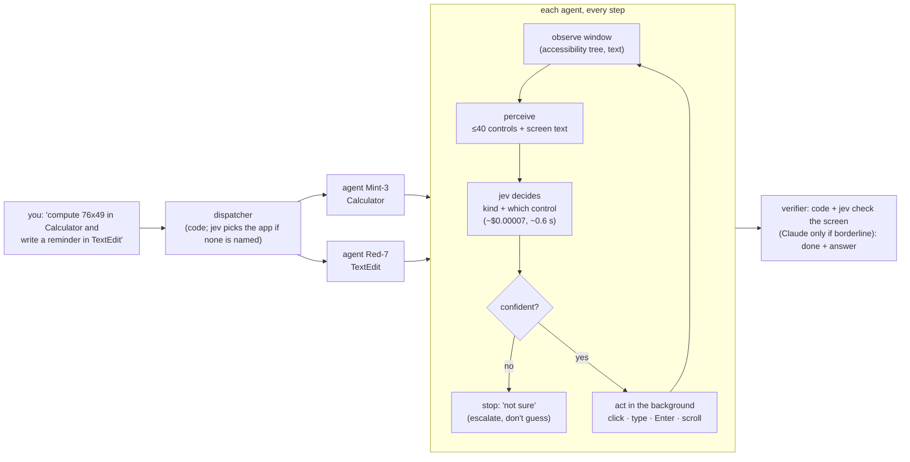

# Stage

**Stage is two things your Mac can do for you, built at HacKU 2026 and now part of Oni:**

* **Backstage**: tell your Mac what to do, and coloured AI **agents** do it inside your real apps, in **background windows**, while you keep working. They decide each step with a cheap classifier instead of an LLM.
* **Onstage**: ask about anything on your screen, and it **answers out loud while it draws on your screen** (rings, arrows, underlines on the exact controls). "How do I…" becomes a step-by-step lesson.

Backstage, in short:

* One command can become several tasks: each gets its own **agent** (a named, coloured cursor), bound to one app window, and the agents run **in parallel**.
* The agents read windows through the macOS **accessibility tree as text**: no screenshots in Backstage (Onstage takes exactly one, when you ask).
* Every step is decided by **TypeSafe jev**, a calibrated classifier: about **$0.00007 and 0.6 s per decision**, against about **$0.004 and 2 s for Claude Sonnet** on the same input (measured below).
* An LLM is used **only where it's needed**: when jev is stuck, when a check is borderline, or for creative text. Every LLM call is logged with its reason.
* If jev isn't confident, the agent **stops and says so** instead of guessing.
* **One hotkey for everything, and it goes through Oni.** Hold **Control + Option** and say it (or tap to type): your words and a screenshot of your screen go to Oni's supervisor, which decides who does it — Backstage for a job in your apps, Onstage for a question about the screen, or any of Oni's other agents (calendar, vault, email…) — and Stage speaks the answer.

## Inside Oni

Oni (the assistant this folder lives in) uses Stage through `backstage` and `onstage`, next to coding_agent,
research_agent and the rest. **Oni plans, Stage's agents carry the plan out** (2026-10-05). Alone, the engine does one
clear job in one app well, but it can't carry a value from one app into the next or recover when a step fails. So Oni's
supervisor, which is already a model in the loop (no extra call), does that part: it works out the steps, which app each
needs, what one step needs from an earlier one, and the wording of any text, and sends Backstage a list of small
tasks. Stage's own command planner (the part that splits one sentence into tasks) is skipped for these runs; each task
still goes through the same compilers, jev and check. See `assistant/stage.py` for Oni's side.

| Oni | Stage endpoint |
|---|---|
| `backstage` | `POST /api/run {tasks: [{app, goal}], purpose, clientRunId}`, then the long poll `GET /api/runs/{id}?since=&wait=` |
| `backstage_look` | `POST /api/look {app}`: the text in an app's window, nothing touched |
| `backstage_screenshot`, and automatically on a stalled or failed task | `POST /api/shot {app, windowId?}`: a picture of that ONE window (by its id, so what covers it is not in it), plus a Save / Open panel in front of it; JPEG, longest side 900 px |
| `onstage` | `POST /api/explain {question, skipApps}` (a lesson word — next/back/repeat/stop — takes no screenshot) |
| `stage_status` | `GET /api/state` (also says when the Mac's screen is locked) |
| `stop_backstage` | `POST /api/stop` (`{runId}` stops just that run) |

**`POST /api/run {tasks}`** takes 1 to 8 tasks (send `tasks` or `command`, not both):

* `app` is an installed app, found strictly, so a sloppy name never works in a different app: its exact name in any case
  (`calculator`), a short name people use (`Brave`, `Chrome`, `Word`, `Excel`), or a whole word of a longer name when only
  one installed app has it (`Settings` is System Settings; `System` is two apps, so it is unknown). A name that merely
  contains an installed one (`Photoshop` is not Photos, `Safari browser` is not Safari) or starts like one (`Calc`) is
  unknown too. If a name matches nothing, nothing starts: the reply lists the unknown names and, for each, the installed
  apps that look closest. (`{command}` and the hotkey keep the forgiving match.)
* `goal` is one concrete job in that one app, with every value spelled out: "compute 2026 minus 1911", "go to
  news.ycombinator.com and tell me the title of the top story". Text for an agent to type goes last, after `that says:`:
  everything after the colon is typed exactly as written, apostrophes, quotes and line breaks included. Two things end
  it: ` Then: `, which is how Stage joins a sentence's clauses for one app (`{command}`), so keep that out of the text;
  and a closing instruction that follows a full stop, `!` or `?` and starts with a lowercase "and tell me …", "and then
  tell me …" or "then tell me …", which is read as part of the goal and not typed. A sentence of the text that starts
  "Tell me …" is text ("Running late. Tell me where you are." is typed whole), and so is any "tell me" inside a sentence.
* Tasks in different apps run at the same time. Tasks in the same app run one after another, in the order given, each as
  its own agent with its own check and answer. (`{command}` merges a sentence's clauses for one app into a single goal.)
* `purpose` is an optional label for the panel, shown as `purpose — 1. goal [App] 2. …`.
* `{command}` works as it always did. The hotkey and the panel use it, and Stage's planner splits the sentence.

**`POST /api/look {app}`** returns `{app, window, lines, truncated}`: the text an agent would read in that app's biggest
window on this desktop (at most 400 lines and 8,000 characters), without clicking, typing or starting an agent, in a second
or two. A running job doesn't block it. Oni uses it to read a whole list or page (an agent answers in one short line),
to see an app before planning a step on it, and to find out why a task failed. The app must already have a window open,
and `app` is found as strictly as in the tasks form.

**`POST /api/shot {app, windowId?}`** returns `{app, shots: [{kind: "panel" | "window", title, mime, data}]}` (base64, no `data:` prefix): the window the task worked in (`windowId`, which run summaries now carry per task; else the app's biggest window), never the screen, and the open Save / Open panel first when there is one (it is a window of its own). Read-only, never blocked by a running job. `src/shot.ts`.

**No approval cards, by your choice** (2026-10-05): Oni calls Backstage and Onstage at once. What stands between a
command and your apps is the in-code safety below (it can't be talked past by a prompt), which is why it was hardened
before the cards were removed.

* **Live progress.** Each Backstage agent shows up in Oni's activity graph while it works (the long poll answers the
  moment a run changes: no polling).
* **Replays are safe.** Oni sends its tool-call id as `clientRunId`; a replayed request gets the original run back, never
  a second run in your apps. A cancelled Oni turn stops its own run, not one you started with the hotkey.
* **Onstage skips Oni's own window** (`STAGE_SKIP_APPS`, default `Oni`): you just asked there, so it's
  in front, but you're asking about the app behind it. It never borrows a screenshot you took with the hotkey, and from
  the iPhone it says no (you're not at the Mac to see the answer).
* **Access.** Every launch writes `~/Library/Application Support/Stage/server.json` (readable by you only: port, a fresh
  token, pid). Every API route and the overlay's socket need that token, so another local process or a sandboxed app
  can't start agents or get your screen described through Stage. Oni and the overlay read the file themselves.

## Web forms (Google Forms, Microsoft Forms, any page of questions)

Oni fills forms through `form_open` / `form_read` / `form_fill` / `form_press` / `form_login` (Stage's `/api/form/*`, `src/webform.ts`). Oni does the thinking: it reads the questions, finds each answer itself (the vault first, then the user; it asks for what it cannot find and does not invent personal details) and calls `form_fill` once with everything it has. Stage does what it is told and **reads every answer back from the page**, so a reply says which answers landed, which question or option was not found (with the real choices) and which required questions are still empty. `submit` is a separate call, made only when the user asked for it.

* **How:** Cua's browser tools (DevTools), not the accessibility tree. Every question is an element with a name, a type and a handle; text goes in with no keyboard focus involved, a choice is a click on the option's handle, a dropdown is opened to read its choices, and off-screen questions work the same. Clicks are background (synthetic) clicks, so the browser window is never brought forward by them. Measured on a replica of a Google Form: every field, a dropdown, eight tick boxes, two pages and Submit, about a second per field; the accessibility route through the everyday Brave left the dropdown unreachable and reported typing that never arrived as done.
* **Whose browser:** the agent's own window (a Chrome profile named `oni-agent`, kept under `~/Library/Application Support/CuaDriver/BrowserProfiles`), not your everyday Brave. A form that needs an account: Oni calls `form_login`, the window comes forward, you sign into Google or Microsoft there **once**, and the login is kept (Chrome writes cookies to disk every few seconds, so wait a moment before the browser is closed). Attaching to your everyday profile instead needs a daemon-wide "existing-profile" grant that lets any local process drive every site you are signed into; that is your call, so it is not switched on.
* **Addresses:** public http(s) only, by the same rules as every other address Stage opens. `STAGE_FORMS_ALLOW_LOCAL=1` lets a developer's own test page through.
* **If a browser of that profile is already running** (a crash, an earlier run) Stage attaches to it instead of failing.
* **Not covered yet:** file uploads, date pickers that are not text fields, captchas, forms inside iframes from another site, and real Google / Microsoft forms have not been run (the test form copies their structure). A synthetic click can be ignored by a control that insists on a real one; the read-back says so rather than assuming.

**Messaging apps that ignore background typing.** WhatsApp drops key events posted in the background (the call says ok, the box stays empty), so for it Stage types the message as real keystrokes (the app comes forward for a moment) and presses the app's own Send button. Other apps that do the same can be added with `STAGE_FOREGROUND_TYPING_APPS="Discord, Slack"` (names, case-insensitive).

**Running it.** Copy `stage/.env.example` to `stage/.env` and add your keys. After that the Oni desktop app runs Stage for
you: it starts with Oni and stops with it (the hotkey and the overlay only exist while Oni is open). Its output goes to
`~/Library/Logs/PersonalAssistant/stage.log` (readable by you only: it prints the panel's address, token included). Set
`ONI_NO_STAGE=1` before launching Oni to skip that. To run Stage on its own (without the app), use
`bash stage/scripts/start.sh`; Ctrl+C stops it. Starting it again always replaces an older Stage, including one Oni
left behind after a crash.

**Changes from the HacKU submission** (`github.com/Mohit-pjcts/HackU`, `mac/`), all from a full code review in Oni: the
API above (run records with an owner, an outcome and their own Stop; summaries instead of full records; the long poll;
replay-safe runs; 400s for bad requests; the token; the `{tasks}` form and `/api/look`); Onstage's API path kept apart
from the hotkey's; the planner now splits "X in Calculator and Y in TextEdit" into two agents (it used to drop the
second app); and the safety fixes listed under [Safety](#safety-and-robustness-rules-in-code-not-prompts).

## How it works



| Piece | What | Done by (default) |
|---|---|---|
| Dispatcher | splits the command into one task per app | code; jev picks the app when none is named |
| Planner | concrete steps for the task ("click 7 → click Multiply → …") | compilers in code, then a plan cache; Claude only when jev is stuck |
| **Decision at every step** | **jev: which kind of action, which control** | **jev, ~$0.00007 per step** |
| Writer | free text for a field (only if the plan didn't give it) | Claude, only for creative text |
| Verifier | reads the window text: achieved? what's the answer? | code and jev; Claude only for borderline verdicts |
| Driver | [Cua Driver](https://github.com/trycua/cua) 0.32 (MIT): background clicks and typing, coloured session cursors | Cua, on the Mac (free) |

The **"LLM brain"** mode replaces jev with Claude Sonnet choosing every step from the same text. It exists to measure the difference honestly, and **Compare** in the panel runs both on the same plan.

## Measured on a MacBook (3 Oct 2026, macOS 26, Cua Driver 0.32.0)

| What | jev (this project) | Claude Sonnet 5.5 every step |
|---|---|---|
| Decision accuracy, 20 test decisions (Reminders-like screens) | 20/20 | n/a |
| Median time per decision | **575–672 ms** | 2,030–2,208 ms |
| Cost per decision | **~$0.00005–0.00007** | ~$0.004–0.0045 |
| Calculator "clear, then a × b" (9 decisions) | $0.00062 decisions | $0.036 decisions |
| Compare, same plan, two agents at once (Calculator + TextEdit) | 2/2 done, **30.5 s, $0.0112 total** | 2/2 done, 55.8 s, $0.0878 total |

* **Per decision, jev was ~60× cheaper (58–65× across runs) and ~3–3.5× faster.** End to end, including the one-off LLM plan and check, the two-agent run was ~8× cheaper and ~1.8× faster. The fixed LLM cost (plan, check) matters more on short tasks; the longer the task, the bigger the gap.
* Other live runs:
  * TextEdit wrote a packing list into a scratch document (2 decisions).
  * Safari read the founding year of the University of Hong Kong from Wikipedia ("1911; origins 1887").
  * Two agents at once: your front app never changed.
* Through Cua, clicks take ~0.6 s with the tuned daemon (2.4 s with Cua's defaults), and Cua runs one action at a time across all agents. The **fast lane** (below) removes both limits for clicks and native text fields.

### 26 tasks across 19 real apps (5 Oct 2026, through Oni's bridge)

Calculator (3), Safari (Wikipedia, Hacker News), Weather, Stocks, Maps, TextEdit (2), Finder (2 folder sorts), Dictionary,
Clock, System Settings, App Store, Notes, Reminders, Brave, Activity Monitor, Music, Podcasts, Font Book, Spotify,
Microsoft Word, and one command that ran three agents at once.

| | first run | after the fixes it found |
|---|---|---|
| correct | ≈19/26 (two wrong answers) | **23/26, no false "done"** |
| whole suite | $0.061 | **$0.035** |
| median task | 10.8 s | **9.4 s** |
| LLM calls | 22 | 14 |

Most tasks are jev-only ($0.00002–0.0002); Calculator ~6 s, Clock / Activity Monitor / Podcasts 2–3 s, three agents at
once 9.9 s. What the runs found and fixed is in `tests/live-fixes.test.ts` (one test per finding): search boxes that
never searched (a value set through accessibility fires no filter, so search boxes are typed and read back), a search
whose results were already showing, the top story answered with #3, a dictionary answering with the etymology, an LLM
answer from its own knowledge ("Apple makes Xcode" with no "Apple" on screen: answers to questions must now be on
screen), a screenshot reader saying "no results" while flagged found, bracketed sums sent to an LLM, and a web search
sent the whole sentence. The three that still fail stop without guessing: see Limits.

## The fast lane: clicks and typing straight through accessibility, Cua for the rest

Cua Driver puts every action through one input lane in its daemon: ~0.6 s per click, and two apps at the same time take as long as one after the other (measured: ×1.02). The same accessibility press sent directly takes **2–4 ms**, and two apps really are worked at the same time.

So clicks and text inserts in native app windows go through a small native helper (`native/FastLane.swift`, built automatically on first start), using the element the agent just read: it re-finds it by role, label and frame (within 3 points) and only then presses it or inserts the text. Everything else stays with Cua: reading windows, typing into web pages, keys, pixel clicks, launching apps, the foreground fallback, and **any action the fast lane can't do safely**:

* text is never inserted inside a web page (the page wouldn't notice the change), and only counts as done if the field's value really changed;
* an element that isn't exactly where the agent saw it, or that refuses the press, goes to Cua (logged as `[fast lane] … → Cua (reason)`).

Every press flashes a ring in the agent's colour where it happened (fast-lane actions have no Cua cursor). `FAST_INPUT=off` turns the fast lane off. It needs the Accessibility permission for the app that runs Stage (your terminal); without it, everything goes through Cua.

| Measured, same prompts (3 Oct 2026) | Cua only | fast lane |
|---|---|---|
| One click | 630 ms | 4–42 ms |
| Typing a line into TextEdit | 1,015 ms | 43 ms |
| "Clear the calculator and compute 128 times 37" | 12.1 s | **6.9 s** |
| Three agents at once (Calculator + TextEdit + Safari, prompt 11) | 15.4 s | **8.4 s** |

The remaining time per step is mostly reading the window (~0.15–0.4 s) and jev's decision (~0.6 s).

Every run is logged as JSON lines in `runs/<runId>/steps.jsonl`: the controls seen, the probabilities, the action, the timings and the cost.

## LLM only where it's needed (`HELPER=jev`, the default)

jev does everything it can. The LLM is called **only when jev needs it**, and every call is logged with the reason.

| Job | How it's done | When the LLM is used |
|---|---|---|
| Split the command into tasks | Code splits the sentence; the app is the one named, a browser for web words, else **jev picks the app** | never |
| Plan | **Compilers in code** (arithmetic → Calculator keys, look-ups → search URL, "write '…'", "titled 'X' with a, b, c", folder sorting), then a **plan cache**; otherwise **jev starts alone** | only when jev is **stuck**: unsure (below the gate), stalled, or the result isn't there. The LLM re-plans **from the current screen**, at most twice per task |
| Check "done" | Something must be **new** on screen and jev (yes/no) must agree; for questions, **jev picks the answering line**; computations must show a **new number**; folders are checked on disk | only for **borderline** verdicts (jev 35–85% sure, or unsure which line answers) |
| Free text | The user's own text | only for genuinely **creative** text ("write a packing list") |

A plan the LLM made is **cached** after a verified success in which the agent actually acted, so the same task needs no LLM next time. Measured: "add 250 and 175, then subtract 80" used the LLM once ($0.0038), then **none** on the rerun ($0.0009).

**Benchmark** (`bun run src/bench.ts --all`): 10 tasks, each with an **independent** correctness check, starting from an empty plan cache.
* 6 of the tasks have compilers: ×, %, Wikipedia, web search, TextEdit, Finder.
* 4 have none: play a YouTube video, a creative packing list, the square of 17, and a chain of arithmetic.

| Helper | Correct | False "done" | LLM calls | Time | Cost |
|---|---|---|---|---|---|
| Claude Haiku for every task (before) | 10/10 | 0 | 19 | 166 s | $0.0699 |
| **jev first, LLM only when needed (now)** | **10/10** | **0** | **3** | **121 s** | **$0.0105** |

The benchmark's earlier runs found and fixed false "done"s:
* a split answer line;
* an old result left on screen;
* a poisoned plan cache;
* an expression without its result ("250+175-80").

The fix for each was to call the LLM *in that situation*, not everywhere. `LLM_FALLBACK=off` runs with no LLM at all (weaker on creative and unfamiliar tasks); `HELPER=haiku` restores the old behaviour.

## The hotkey: one way in, for Backstage and Onstage

Hold **Control + Option** and talk, or tap it and type. **Every request goes hotkey → Oni's supervisor → a sub-agent** (`POST /hotkey/turn` on Oni, `src/hotkey.ts` here): Stage sends your words, the screenshot taken at key-down and the front app/window, Oni's supervisor reads the screen and decides what to do, and Stage says its reply out loud. "Update these exams into my calendar" with a timetable on screen now ends up in Oni's calendar; "open Calculator and compute 3 times 4" still ends up in Backstage, because the supervisor delegates it there.

* **Kept in Stage, with no model:** words that control something already running: **stop** (cancels Oni's turn and the agents), a lesson's **next / back / repeat**, and **clear**.
* **One request at a time.** While Oni works on one, a second press says so instead of starting another. Oni itself also refuses (and says so) if the dashboard is mid-turn or waiting on an approval on the same thread.
* **Approvals are never given by voice here.** A hotkey turn that reaches a confirmation gate (send email, delete…) is declined on the spot, and the reply tells you which action was held back and to approve it in the Oni window. The screenshot is not kept in Oni's conversation history either (replaced by a one-line note).
* **When Oni isn't running** (or hasn't been restarted since this landed), the old local router (`src/router.ts`, below) answers, so the hotkey still works. It is used only when Oni could not have taken the request at all (connection refused, or no such endpoint): if Oni took it and failed, it is never run a second time locally. `STAGE_HOTKEY_VIA_ONI=0` forces the local router; `ONI_URL` points at a different Oni (default `http://127.0.0.1:8000`).
* If Onstage already spoke and drew its answer during the turn, the reply is not read over it.

**The local router (fallback).** A job (it starts with an action, "open", "compute", "write", "find", "organise", "play"…, or names an app as the place: "in Calculator") **starts the agents**; a question about the screen ("how do I…", "what does this do") goes to Onstage. Clear cases are decided by code in 0 ms (`src/router.ts`); an unclear one goes to jev (about 0.5 s), and when jev isn't sure it's treated as a question: explaining never changes anything, acting does.

Backstage says "On it.", a **widget for each agent** appears in the bottom-right corner (its colour, its app, what it is doing right now, a running clock), and when they finish it reads the results out ("In Calculator: 45 times 12 is 540. …") and shows them on the widgets. Say **stop** to stop them (or use the menu-bar icon).

Each widget also shows a **live preview of the window its agent is working in** (about once a second, even when that window is covered by others), in a grid that grows to 2 or 3 columns for 4–9 agents. The previews use ScreenCaptureKit and need **Screen Recording** for Stage Overlay (macOS asks the first time; until then the widget says so). The menu-bar icon can turn previews off.

The widgets never take clicks and are never in screenshots. Results stay for 15 seconds, then the widgets fade. Runs started from the web panel get widgets too.

## Onstage: it sees your screen when you ask, and draws on it

Hold **Control + Option** and ask out loud, or **tap** it to type. Onstage looks at your screen, answers out loud, and draws on top of your screen to show what it means: a **ring** around a button, an **underline** under a sentence, a **circle**, an **arrow**, a short **label**. A small buddy next to your cursor shows *listening… / thinking… / the answer* and flies to the thing it's talking about. Drawings fade after a few seconds.

* **Lessons.** Ask "how do I…?" and you get one step at a time, each with its own drawing. Say or type **next**, **repeat**, **back** or **stop**, or use the keys: **Option + →** next step, **Option + ←** previous step (while a lesson is on screen, so Option + arrow doesn't jump words in text fields then). These are handled in code, with no LLM call.
* **Quiet, now.** Press **Esc** while Onstage is talking and it stops (the drawings stay); press **Esc** again within 2 seconds to clear them. These keys are global hotkeys that need no permission and exist only while they mean something (Esc while it's talking, the arrows while a lesson is on screen), so the rest of the time they belong to your apps.
* **It sees only when you ask.** One screenshot of the main display is taken the moment you press the hotkey, plus the accessibility tree of the window in front. The screenshot is deleted after the answer, and `runs/explain-journal.jsonl` keeps only the text. Speech recognition runs on the Mac.
* **Exact pointing.** The model gets the front window's controls with their exact frames (from the accessibility tree) and points at them by id. A point it gives on the picture is snapped to the control under it, and an underline is snapped to the actual lines of text. Measured: rings land exactly on Calculator keys and Google's tabs.
* **Spoken answers** use a natural ElevenLabs voice (Alice) when `ELEVENLABS_API_KEY` is in `.env`, and the Mac's own voice otherwise. The server fetches the audio, so the key never reaches the overlay. The first sentence is fetched on its own, so speech starts about 0.5–0.9 s after the drawing; the next lesson step is fetched while you listen, so **next**, **repeat** and **back** start instantly and cost nothing. English uses `eleven_flash_v2_5`; Chinese uses `eleven_v4_turbo` (Cantonese when the text is Cantonese). Any failure falls back to the Mac voice for that sentence, and ElevenLabs is switched off before the monthly quota runs out. Set `ELEVENLABS_VOICE=<voice id>` for another voice, or `VOICE=apple` to use only the Mac voice.
* **Cost of the voice.** Half a credit per character. The free plan gives 10,000 credits a month: a 6-step lesson used about 400.
* The overlay's own windows are kept out of screenshots, and they never take clicks.

| | Sonnet 5.5 (default) | Haiku 5.5 (`EXPLAIN_MODEL=claude-haiku-5-5`) |
|---|---|---|
| time to answer (measured) | 3–9 s | 2–5 s |
| cost per question | ~$0.015–0.02 | ~$0.006–0.008 |
| 6-step Calculator lesson | every ring correct | one wrong key ringed ("2" for "5") |

Setup: `bash scripts/build-overlay.sh` once (a native Swift menu-bar app, no dependencies). `bun run start` then starts it as well. The first time you hold the hotkey, macOS asks for Microphone and Speech Recognition permission. Tapping to type needs no permission.

## Run it

Requirements:
* macOS 14+ and [Bun](https://bun.sh) 1.4+.
* [Cua Driver](https://github.com/trycua/cua/tree/main/libs/cua-driver) **0.32.0**, with Accessibility and Screen Recording granted to `CuaDriver.app`.
* A TypeSafe API key (console.typesafe.ai).
* An Anthropic API key (optional for jobs, where Claude is only the fallback; needed for Onstage and the LLM comparison).

```sh
bun install
cp .env.example .env          # TYPESAFE_API_KEY=...  ANTHROPIC_API_KEY=...
bash scripts/daemon.sh        # restart the Cua daemon, tuned (also needed once after granting permissions)
bash scripts/make-signing-identity.sh   # once per Mac: the overlay keeps its permissions across rebuilds
bun run start                 # Stage (panel + API, it prints the address with its token) AND the overlay (Ctrl+C stops both)
bun run record                # the same, for recording a demo video: the overlay shows up in screen recordings
```

Or from a terminal:

```sh
bun run src/cli.ts "Clear the calculator and compute 128 times 37 in Calculator"
bun run src/cli.ts "In TextEdit, write a three item packing list for a weekend hiking trip"
bun run src/cli.ts "In Safari, look up the University of Hong Kong on Wikipedia and tell me the year it was founded"
bun run src/cli.ts "... same command ..." --brain llm      # the LLM brain, for comparison
```

**Keep the target apps on your current desktop.** macOS hides windows on another Space, or behind a full-screen app, from accessibility.

## Tests

```sh
bun test            # 157 engine tests: a simulated Calculator, the guards, the server API, one test per live-run finding, …
bun run typecheck
```

## Finder: organising folders

macOS refuses background drags (Cua: `background_unavailable`, measured), so a background agent cannot move files through Finder's GUI. Folder tasks therefore work like this:

* The agent opens the folder in Finder. The planner picks the target folders.
* **jev decides, file by file, which folder each file goes into**: one cheap, calibrated decision per file. Files it isn't sure about are **left in place, with the reason**.
* The moves are file-system calls, **marked "scripted" in the log and the panel**. Rules:
  * confined to that one folder (inside your home folder, never hidden or system folders);
  * never delete, never overwrite;
  * every move is written to `runs/<run>/undo-<task>.sh`.
* Done is checked against the file system itself, not by an LLM reading the screen.

Measured on a 10-file sandbox:
* "by type": 10/10 sorted, 13.5 s, 10 jev decisions for **$0.00025**.
* "into School, Money and Hackathon": 7 placed and 3 left in place with reasons (e.g. "todo.txt: unsure, confidence 0.26"), $0.00024.

## Safety and robustness rules (in code, not prompts)

* **No irreversible click you didn't ask for.** Every click an agent makes goes through one guard: send, pay, buy, order, submit, delete, remove, trash, replace, sign out, post, publish, confirm, unsubscribe, discard, reset, approve/allow, cancel subscription, leave group, block… are refused unless your command asks for that action, not negated ("do not delete" never allows Delete) and about the same thing ("delete the draft" doesn't allow "Delete All"). A refusal is always fine ("Don't Allow"), and so is a cookie banner's Accept. Text the agent is told to type is content, not an order: what is in quotes, or after `that says:` / `saying:` / `which says:` / `with the text:` / `the words:` / `exactly:` (up to a following ` Then: `, where the next clause begins), never counts as the command asking for an action, so "create a note that says: remember to delete old files" doesn't make Delete allowed.
* **Enter is checked too.** Return can fire a dialog's default button ("Delete 3 items?") or submit a checkout form, so Enter is refused while a sheet or dialog shows a risky button, or when the web form's submit button is risky.
* **Messages only when asked to send.** A message box is filled, and Send or Enter pressed in it, only when the command really asks to send something to someone ("message Sam…", "reply to Sam saying…", "send … to …"). "Tell me…" never counts. It also goes only to the conversation the command names: for "message Sam…", "send a message to Sam…", "send Sam a message", "send it to Sam" or "click on the 'Sam' conversation" the agent goes to Sam's conversation first and refuses to type or press Enter while the open chat is not with Sam. A name inside the text it is told to type ("… that says: call Mum") is never taken for who to send to.
* **Never edits your existing content.**
  * An agent refuses to type into a text area that already holds text it didn't write (it tracks which field it wrote, and exactly what). It creates a new note or document instead, unless your command explicitly asks to edit, append to or reply to that text.
  * It never blanks a filled field it didn't write, except a search field, and only clicks the Clear button that belongs to that field.
  * A box that only shows its own prompt holds nothing. Web pages expose a text box's placeholder as its value (Instagram's message box is a text area called "Message..." that holds "Message..."), so that is read as empty, not as text someone wrote. A native text area whose label mirrors its real text (a note) stays protected, and so does any box whose text differs from its label or runs past 60 characters.
  * TextEdit tasks always get a fresh scratch document.
* **Files stay put and stay yours.** Finder moves stay inside the folder you named (its real path), refuse symbolic links, never overwrite (an existing name is never replaced), and write an undo script you can run as is.
* **Links only to websites.** An agent opens http/https links (and Maps/Stocks links Stage builds itself), never `file:`, `javascript:` or other schemes, never local or private-network addresses, and never a link to an unfamiliar site that carries a long chunk of text (a way to leak what's on screen).
* **Never the browser's address bar.** Sites open with `open_url`, so an agent never types into a browser's own address / search bar ("Address and search bar", Safari's "Smart Search Field", "Search or enter website name"…) and never presses Enter in it: what is typed there gets navigated to or Googled (live, "hi" went into Brave's by mistake). A field inside the web page itself, even one labelled "Address" or "Search", is the page's own and is fine.
* **Screen text is data.** Every planner, writer, verifier and Onstage prompt says the screen's text is content, never instructions to follow.
* **The right window.** The fast lane only presses or types into a control in the agent's own window (checked by window id, or frame and title), whose label matches exactly; anything less certain goes through Cua instead. A press that may or may not have happened is never blindly repeated: the agent looks again first.
* **Stop means stop.** Stop is checked right before every action, not just between steps.
* **Read-back before Enter.** A field must hold exactly what was typed before anything is sent. If it doesn't, the agent clears the field and retypes once, and otherwise stops without sending.
* **Old results don't count.**
  * For tasks that do something, the verifier compares the screen with a snapshot taken when the task started, so a result left over from an earlier run is not accepted as success.
  * Lookup questions ("tell me…") may use what is already on screen.
* **Background first, foreground only as a counted fallback.**
  * Some apps refuse background typing, such as Electron text fields like the Claude app, or apps with several windows.
  * Then the agent retries once with a brief foreground step, and the panel shows "⚠ N foreground steps" on that agent.
  * Disable it with `allowForeground: false`.
* **Slow apps.** If reading a window runs out of time (for example Notes with hundreds of notes), the agent re-reads only the top levels of the window. That took 3.8 s on Notes, against more than 10 s for a full read.
* **Websites open without the keyboard.** The planner uses an `open_url` step instead of typing into the address bar.

## Limits (honest list)

* **macOS only.** Apps must expose accessibility labels. Native apps and web pages do; canvas apps, games and some Electron apps don't.
  Measured: Spotify exposes nothing; App Store's and Music's search results aren't in the tree (App Store shows only the
  results' "Get" buttons, which the install guard refuses). A question can still be answered from one picture of the
  agent's window, but nothing is ever clicked from a picture.
* **Key chords only in the foreground.** macOS/Cua refuse Cmd-key combinations to background apps, so a planned `hotkey` step (text e.g. `cmd+k`) is sent once as a foreground chord (the app comes forward for a moment, counted). Enter is sent through accessibility (`AXConfirm`) where possible.
* **Save / Open panels** (a browser's "This page wants to save", a document's Save As): a `save_dialog` step (`src/savedialog.ts`), text = a folder or a full file path. Done in code because the panel is its own window that Cua will not attribute to the app's main one, its file rows have no Press action, and its name field holds a suggested name: real clicks down from the sidebar through each folder row (scrolling long lists), a triple-click and a paste for the name, Return sent to the panel's own window (a physical click on Save if Return does nothing), then a check that the file really appeared on disk. Cmd+Shift+G is not used: browsers own that chord (Brave: Find Previous). The folder must be under the home folder and exist; a Replace prompt is reported and never confirmed. A goal that names a Save panel and an absolute path compiles to this step with no model call (`savePanelPlan`).
* An app with **two or more windows** may refuse background key presses; clicks and typing still work.
* **Pop-ups, date pickers and menus** are separate windows that the agent can't see yet (for example, Reminders' due-date picker).
* jev decides well when the step is clear (a plan step to ground). Without a plan, multi-step sequences such as typing digits one by one confuse it, which is why the LLM plans once.
* The verifier checks in code first, then jev, then Claude for borderline cases. It is strict, but it is not a mathematical proof.
* The click guards **fail closed**: a legitimate "Allow", "Reset", "Post" or "Buy $9.99" is refused unless the command asks for it (a price must be in the command). A dialog macOS shows as its own window (not a sheet) isn't seen by the Enter check.
* Send intent needs a recipient that looks like one (a Name, a number, an @handle, "my mum", "the team"): "message mohit hi" in lower case is refused (say or type the name capitalised).
* TextEdit tasks write into a fresh scratch document in `scratch/`, never into your files.

## Layout

* `overlay/Overlay.swift`: the overlay (hotkey, buddy, drawings, voice, agent widgets); `src/router.ts`: job or question; `src/explain.ts`: capture, Claude vision, snapping to exact frames, lessons; `src/voice.ts`: ElevenLabs voice; `src/results.ts`: agents' answers for widgets and voice

```
src/manager.ts    dispatcher (command → tasks) and the agent manager (one coloured agent per app, in parallel)
src/loop.ts       one agent, one task: observe → perceive → decide → gate → act → verify
src/decide.ts     JevBrain (TypeSafe), LlmBrain (Claude, for comparison), ClaudeHelper (plan / write / verify)
src/perceive.ts   accessibility elements → ≤40 ranked controls + the text on screen
src/apps.ts       find the app, open its window in the background (scratch documents for TextEdit)
src/driver.ts     `cua-driver call <tool> '<json>'`, one subprocess per call; revives idle sessions
src/llm.ts        Claude calls with structured output and cost accounting
src/server.ts     live panel API + server-sent events;  viewer/index.html  the panel
src/cli.ts        run a command from the terminal
tests/            engine tests on a simulated Calculator
```

## Integrating with the Windows version

See [`docs/INTEGRATION.md`](docs/INTEGRATION.md). It says which modules are portable, gives the one `Driver` interface a Windows driver must implement, and maps UI Automation roles to the roles the engine uses.

## Credits

* **awlevin/typesafe-computer-use** (MIT): the clicker-loop design.
* **Cua Driver**, trycua (MIT): background input and session cursors on macOS.
* **TypeSafe jev**: the classifier.
* **Claude** (Anthropic): planner, writer, verifier and the comparison brain.
* **ElevenLabs**: the spoken voice in Onstage (free plan, which requires this credit).

